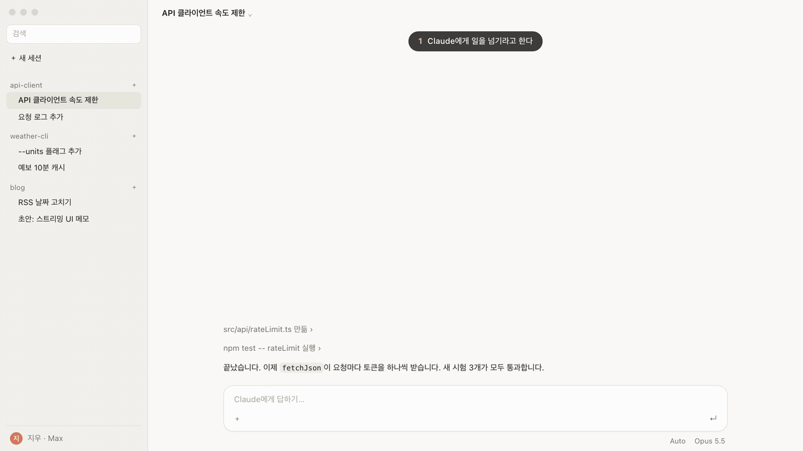

<div align="center">

[English](README.md) · **한국어**

# desktop-handoff

**Claude Code의 대화나 작업을 클릭 없이 Claude 데스크톱 앱의 새 세션으로 넘겨주는 스킬.**

사이드바에 일반 세션으로 바로 열리고, 누를 필요 없이 즉시 작업을 시작하며, 끝나면 원래 세션에 결과를 보고합니다.

[](https://github.com/moneycode11101-svg/claude-code-desktop-handoff/actions/workflows/test.yml) [](LICENSE) [](#지원-범위)



<sub>이 페이지용으로 다시 꾸민 예시 세션이다. 실제 프로젝트 화면이 아니다.</sub>

[설치](#설치) · [쓰는 법](#쓰는-법) · [지원 범위](#지원-범위) · [동작 원리](#동작-원리)

</div>

## 이런 기능입니다

대화가 너무 길어졌거나 별도 주제로 분리하고 싶을 때 사용합니다. 카드를 클릭해서 열 필요 없이 사이드바에 새 세션을 띄워 곧바로 일을 시키고, 완료되면 원래 세션으로 요약 보고서를 돌려받습니다.

## 설치

```bash
npx skills add moneycode11101-svg/claude-code-desktop-handoff -g -a claude-code
```

또는 `git`으로 설치:

```bash
git clone https://github.com/moneycode11101-svg/claude-code-desktop-handoff.git
cp -R claude-code-desktop-handoff/skills/desktop-handoff ~/.claude/skills/
```

설치 후 Claude 데스크톱 앱에서 새 세션을 열어 사용하세요.

## 쓰는 법

Claude 데스크톱 앱(Code 탭)에서 편하게 말하거나 명령어를 입력하세요:

* `"이건 새 세션으로 넘겨"`
* `"새 채팅으로 넘어가"`
* `/desktop-handoff`

**자동 진행 과정:**

1. Claude가 지금까지의 목표, 결정 사항, 핵심 맥락을 요약합니다.
2. 해당 작업 폴더에서 사이드바에 새 세션을 즉시 엽니다.
3. 새 세션이 곧바로 작업을 시작하고, 끝나면 원래 세션에 결과를 보고합니다.

## 지원 범위

|  | 상태 |
| --- | --- |
| macOS 26 (Apple silicon) + Claude 데스크톱 앱 2.31226.1 + Claude Code CLI 2.1.302 | 확인함 (2026-10-17) |
| 더 새 데스크톱 앱 판 | 아직 안 해 봄 |
| Intel 맥, 더 옛 macOS | 아직 안 해 봄 |
| Windows, Linux | 지원 안 함 (macOS `script` 문법을 쓴다) |
| 데스크톱 앱 없이 터미널만 | 지원 안 함 |

`PATH`에 필요한 것:

* **`claude`**: Claude Code CLI, 로그인한 상태 ([설치 안내](https://code.claude.com/docs/en/setup))
* **`jq`**: 최신 macOS 기본(`/usr/bin/jq`) 또는 `brew install jq`
* **`script`**: macOS 기본 내장

## 동작 원리

1. `claude -p`로 가벼운 시드 턴을 실행해 새 세션 ID를 생성합니다 (~3초).
2. `script`와 `claude --desktop --resume <id>`로 앱 사이드바에 새 세션을 등록합니다.
3. `SendMessage`로 인계 요약을 전달해 새 세션이 독립된 환경에서 즉시 실행되도록 합니다.

## 관리 및 개발

**업데이트 및 삭제:**

```bash
npx skills update desktop-handoff -g
npx skills remove desktop-handoff -g
```

*(git으로 설치한 경우: `rm -rf ~/.claude/skills/desktop-handoff`)*

**테스트:**

```bash
git clone https://github.com/moneycode11101-svg/claude-code-desktop-handoff.git
cd claude-code-desktop-handoff
sh tests/new-session.test.sh
shellcheck skills/desktop-handoff/scripts/*.sh tests/*.sh
shfmt -d skills tests
```

## 기타

* **한 식구 프로젝트:** [claude-code-live-viewer](https://github.com/moneycode11101-svg/claude-code-live-viewer)
* **라이선스:** [MIT](LICENSE)
