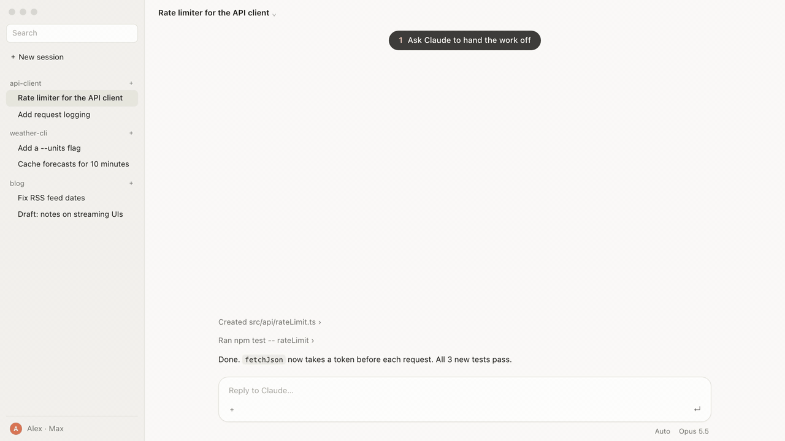

<div align="center">

**English** · [한국어](README.ko.md)

# desktop-handoff

**A Claude Code skill that hands the current conversation—or one topic from it—to a new session in the Claude desktop app.**

The new session appears as a normal session in the app's sidebar, starts working right away with no click, and sends a short report back when it finishes.

[](https://github.com/moneycode11101-svg/claude-code-desktop-handoff/actions/workflows/test.yml) [](LICENSE) [](#requirements)



<sub>A sample session recreated for this page. Nothing in it comes from a real project.</sub>

[Install](#install) · [Usage](#usage) · [Requirements](#requirements) · [How it works](#how-it-works)

</div>

## Why

The desktop app's built-in tool that lets Claude open a new session directly is only present in some app builds, and only works on a turn you typed directly in the app. Everywhere else—other builds, turns woken by a notification or another session, or turns from phone remote control—Claude can only leave a card you have to click or run the work somewhere invisible to the app.

`desktop-handoff` opens a real session in the desktop app's sidebar and starts its first turn right away, without waiting for a click.

## Install

Checked with `skills` CLI 1.7.2 (2026-10-17):

```bash
npx skills add moneycode11101-svg/claude-code-desktop-handoff -g -a claude-code
```

This installs the skill to `~/.claude/skills/desktop-handoff`.

Or install with `git`:

```bash
git clone https://github.com/moneycode11101-svg/claude-code-desktop-handoff.git
cp -R claude-code-desktop-handoff/skills/desktop-handoff ~/.claude/skills/
```

After installing, open a new session in the Claude desktop app.

## Usage

From a Claude Code session in the Claude desktop app (Code tab), ask in plain words—for example, `"hand this off to a new session"`, `"continue in a new session"`, or `"이건 새 세션으로 넘겨"`—or run `/desktop-handoff`.

Claude will:

1. **Write a handoff message** (under about 40 lines, taken from the conversation's conclusions rather than tool output) covering:
   - Goal
   - Latest request (the user's words, verbatim)
   - Constraints (the user's instructions and prohibitions)
   - Done so far
   - Decisions and reasons
   - Open decisions (for the user)
   - Next steps
   - Key facts (numbers, conclusions)
   - Relevant files
2. **Create the session and open it in the app** in that folder by running `scripts/new-session.sh` with the folder, a short title, and its own model ID.
3. **Send the handoff message** to the new session (`local_<uuid>`) with `SendMessage` (or the desktop app's `send_message` tool if `SendMessage` is not present).

The new session's first turn starts as soon as the message arrives. When it finishes, it sends a short report of what it did and what is left back to the session that handed the work off via `SendMessage`.

## Requirements

| | Status |
|---|---|
| macOS 26 (Apple silicon), Claude desktop app 2.31226.1, Claude Code CLI 2.1.302 | Tested (2026-10-17) |
| Newer Claude desktop app builds | Not tested yet |
| Intel Mac, older macOS versions | Not tested yet |
| Windows, Linux | Not supported (uses macOS `script` syntax) |
| Terminal only (without the Claude desktop app) | Not supported |

Needed on `PATH`:

- **`claude`**: Claude Code CLI, signed in ([setup guide](https://code.claude.com/docs/en/setup))
- **`jq`**: `/usr/bin/jq` on recent macOS; otherwise `brew install jq`
- **`script`**: included with macOS

## How it works

1. `claude -p -n "<title>" --output-format json` runs a one-word seed turn (`ready`, with `--effort low --system-prompt-snapshot off` and no tools) in the target folder to create the session and get its `session_id`.
2. `claude --desktop --resume <id>` opens that session as a normal session in the desktop app's sidebar—keeping the folder, title, and model. Because `--desktop` needs a terminal, the script wraps it with `script -q /dev/null`.
3. `SendMessage` (with `to` set to `local_<id>`) delivers the handoff message, and the app starts that turn right away.

`scripts/new-session.sh` launches `claude` in a clean environment (`env -i`) so the new session does not inherit the current session's ID or messaging socket, while passing through sign-in, proxy, and config folder variables (`HOME`, `PATH`, `LANG`, `USER`, `LOGNAME`, `SHELL`, `TMPDIR`, `CLAUDE_CONFIG_DIR`, `ANTHROPIC_API_KEY`, `ANTHROPIC_AUTH_TOKEN`, `ANTHROPIC_BASE_URL`, `HTTPS_PROXY`, `NO_PROXY`).

Measured on 2026-10-17: the seed turn takes about 3 seconds (2.6 s) and costs one extra short model call. End-to-end handoff—an in-app session using this skill to open a new session in the same folder, the new session carrying out the work, and sending its report back—was verified on the tested setup above.

## Update and remove

```bash
npx skills update desktop-handoff -g
```

```bash
npx skills remove desktop-handoff -g
```

If you installed with `git`, pull and copy `skills/desktop-handoff` over `~/.claude/skills/desktop-handoff` again, or remove it with:

```bash
rm -rf ~/.claude/skills/desktop-handoff
```

## Development

```bash
git clone https://github.com/moneycode11101-svg/claude-code-desktop-handoff.git
cd claude-code-desktop-handoff
```

```bash
sh tests/new-session.test.sh
```

```bash
shellcheck skills/desktop-handoff/scripts/*.sh tests/*.sh
```

```bash
shfmt -d skills tests
```

`tests/new-session.test.sh` runs 17 checks against a fake `claude` binary.

## Related

A sister project by the same author: [claude-code-live-viewer](https://github.com/moneycode11101-svg/claude-code-live-viewer).

## License

[MIT](LICENSE)
